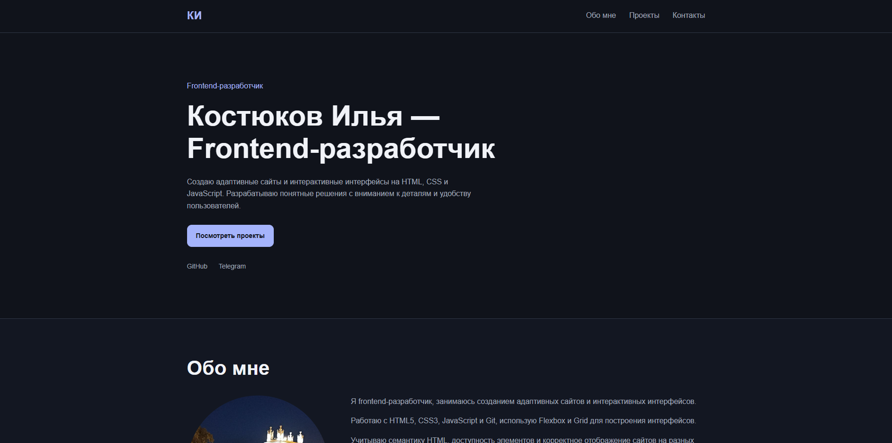
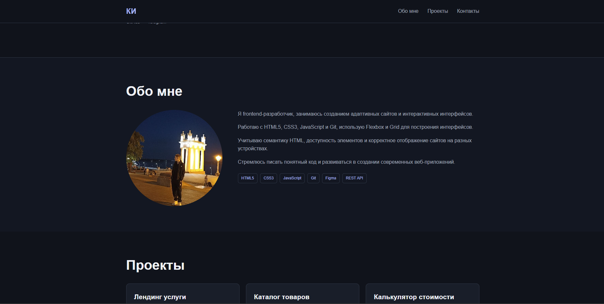
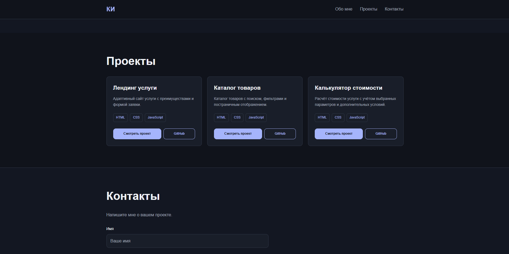
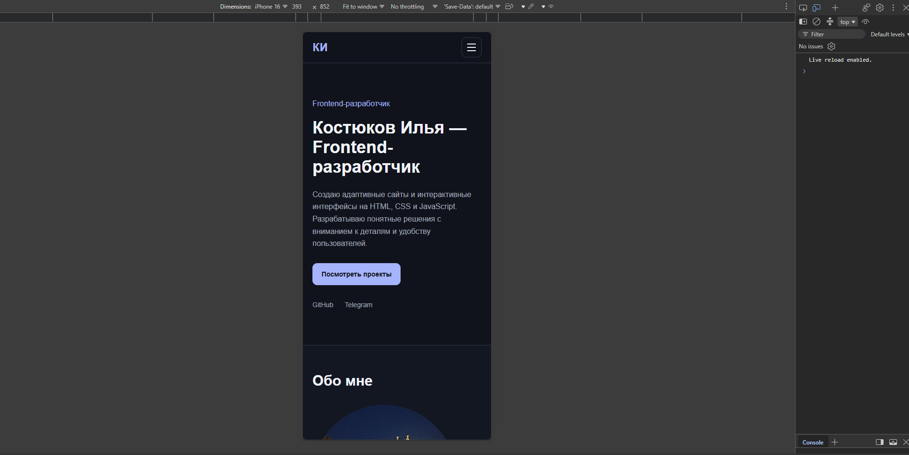

# Костюков Илья — Frontend-разработчик

Портфолио-лендинг с описанием навыков, ссылками на выполненные
проекты и формой обратной связи.

## Стек

- HTML5 (семантическая вёрстка)
- CSS3 (Grid, Flexbox, CSS-переменные, медиазапросы)
- JavaScript (ES6+, мобильное меню, валидация формы)

## Деплой

[Открыть сайт](https://vir010.github.io/portfolio/)

## Как запустить локально

1. Склонировать репозиторий:

   ```
   git clone https://github.com/Vir010/portfolio.git
   ```

2. Открыть `index.html` в браузере или запустить Live Server в VS Code.

## Проекты в портфолио

- [Лендинг услуги](https://vir010.github.io/landing-master-service/) — [репозиторий](https://github.com/Vir010/landing-master-service)
- [Каталог товаров](https://vir010.github.io/catalog-tech-store/) — [репозиторий](https://github.com/Vir010/catalog-tech-store)
- [Калькулятор стоимости](https://vir010.github.io/calculator/) — [репозиторий](https://github.com/Vir010/calculator)

## Что здесь особенного

В этом проекте я применил комплексный подход к анимациям и дизайну. Для появления секций при скролле использована библиотека AOS. Главный заголовок анимируется по буквам с помощью GSAP (SplitText). Также внедрена легкая Lottie-анимация в первом экране для привлечения внимания. Дизайн секции «Обо мне» вдохновлен современными трендами: использована нестандартная типографика (смесь строгого гротеска Inter и курсивного Playfair Display с засечками), а также реализован кастомный эффект плавного появления текста при прокрутке на чистом JS (IntersectionObserver).

## Скриншоты



